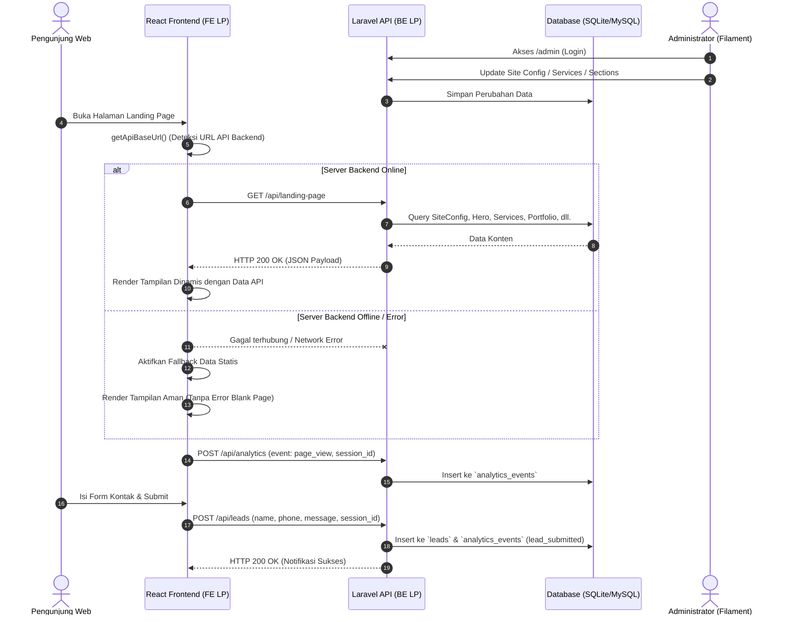

# Dokumentasi Arsitektur & Cara Kerja Sistem (BE LP & FE LP) - PrintHub CMS

Dokumen ini berisi penjelasan komprehensif mengenai **arsitektur teknis**, **struktur data**, **alur komunikasi (data flow)**, dan **cara kerja internal** dari ekosistem aplikasi **PrintHub** yang terdiri dari dua komponen utama:
1. **Backend (BE LP)**: Built with **Laravel** & **Filament v3/v5 CMS Admin Panel**.
2. **Frontend (FE LP)**: Built with **React 19**, **Vite**, **Tailwind CSS v4**, & **Lucide Icons**.

---

## 1. Ringkasan Sistem (System Overview)

Ekosistem PrintHub dirancang menggunakan pola **Headless CMS / Decoupled Architecture**:

```
+-----------------------------------------------------------------------+
|                           ADMINISTRATOR                               |
+-----------------------------------------------------------------------+
                                   |
                                   v (Kelola Konten & Analytics)
+-----------------------------------------------------------------------+
|                           BACKEND (BE LP)                             |
|  - Laravel 11/13 REST API                                             |
|  - Filament Admin Panel (/admin)                                      |
|  - Database (SQLite / MySQL)                                          |
+-----------------------------------------------------------------------+
        ^                                               ^
        | (JSON Payload)                                | (POST Analytics/Leads)
        v                                               |
+-----------------------------------------------------------------------+
|                          FRONTEND (FE LP)                             |
|  - React 19 Single Page Application (SPA)                             |
|  - Dynamic Rendering & Lucide Icons Engine                            |
|  - Dynamic WhatsApp CTA Redirect                                      |
|  - Automatic Fallback Engine                                          |
+-----------------------------------------------------------------------+
                                   ^
                                   | (Interaksi Web & WA Chat)
+-----------------------------------------------------------------------+
|                             PENGGUNAS / KLIEN                         |
+-----------------------------------------------------------------------+
```

### Karakteristik Utamanya:
1. **Pengelolaan Konten Dinamis**: Administrator dapat mengubah seluruh teks, banner, daftar layanan, galeri portofolio, ulasan pelanggan, berita, hingga toggle aktif/nonaktif setiap section langsung dari Admin Panel tanpa perlu mengubah kode frontend.
2. **Dynamic WhatsApp Converter**: Setiap tombol aksi di Frontend secara otomatis terhubung dengan nomor WhatsApp aktif di CMS dan menyusun pesan otomatis yang kontekstual.
3. **Resilient Frontend (Graceful Fallback)**: Jika server backend mengalami kendala atau *down*, Frontend React tetap dapat berjalan normal menggunakan data *fallback* lokal.
4. **Analitik Interaksi Real-Time**: Sistem mencatat `page_view`, `click_wa`, dan `lead_submitted` beserta `session_id` dan `IP address` pengguna ke dalam database backend.

---

## 2. Spesifikasi Teknologi (Tech Stack)

### A. Backend (BE LP)
* **Framework**: Laravel 11/13 (PHP 8.3+)
* **Admin Panel**: Filament v3 / v5 (Livewire, Alpine.js, Tailwind CSS)
* **Database**: SQLite (default `database/database.sqlite`) / MySQL
* **Authentication**: Sanctum (untuk API terproteksi) & Filament Session Guard
* **Architecture**: RESTful API Controller, Eloquent ORM, Seeders & Default Aggregators

### B. Frontend (FE LP)
* **Library UI**: React 19
* **Build Tool**: Vite 8
* **Styling**: Tailwind CSS v4 (Desain Modern, Glassmorphism, Responsive)
* **Icons**: Lucide React Icons (Rendered dynamically)
* **State & Flow**: React `useState`, `useEffect`, View State Switching (Home, News List/Detail, Activity List/Detail)
* **Communication**: Native Fetch API dengan Auto-Detection API URL

---

## 3. Diagram Arsitektur & Alur Data (Data Flow Diagrams)

### A. Diagram Komunikasi Client-Server & Fallback Engine



---

## 4. Struktur Direktori Proyek

### A. Backend (`BE LP/`)
```
BE LP/
├── app/
│   ├── Filament/                  # Resource & Form Panel Admin Filament
│   │   ├── Resources/             # CRUD Modul (SiteConfig, Hero, Service, Portfolio, dll)
│   │   └── Widgets/               # Widget Dashboard (VisitorChart, AnalyticsOverview, SalesChart)
│   ├── Http/
│   │   └── Controllers/
│   │       ├── LandingPageController.php  # Aggregator JSON Payload GET /api/landing-page
│   │       ├── NewsController.php         # Endpoint Berita (List & Detail)
│   │       ├── ActivitiesController.php   # Endpoint Dokumentasi/Kegiatan
│   │       ├── AnalyticsController.php    # Endpoint Log Analitik Pengunjung
│   │       └── LeadsController.php        # Endpoint Form Kontak/Pesan Lead
│   └── Models/                    # Eloquent Models (28 Models)
├── database/
│   ├── database.sqlite            # Database Default
│   ├── migrations/                # Skema Struktur Tabel Database
│   └── seeders/                   # Data Awal / Default Seeder
├── routes/
│   ├── api.php                    # Route API Publik
│   └── web.php                    # Route Web Admin & Storage Link Helper
└── composer.json
```

### B. Frontend (`FE LP/`)
```
FE LP/
├── src/
│   ├── App.jsx                    # Core Application Component (View Manager, State, Component Renderers)
│   ├── App.css                    # Custom CSS Styles
│   ├── index.css                  # Tailwind CSS Directives & Layout Utilities
│   └── main.jsx                   # React Application Entrypoint
├── public/                        # Static Assets & Favicon
├── index.html                     # HTML Template
├── vite.config.js                 # Vite Bundler Config
└── package.json                   # Dependency React 19, Lucide, Tailwind
```

---

## 5. Model Data & Skema Database Utama

Backend menggunakan Eloquent ORM dengan tabel-tabel utama berikut:

| Nama Model | Nama Tabel | Deskripsi & Peran Utama |
|---|---|---|
| `SiteConfig` | `site_configs` | Pengaturan umum situs: Nama, WhatsApp, Email, Alamat, Sosmed, Warna Tema (`primary`, `secondary`, `accent`), Judul Section. |
| `HeroSection` | `hero_sections` | Teks headline, sub-headline, badge, dan URL tombol banner utama. |
| `HeroBackground` | `hero_backgrounds` | Konfigurasi banner background hero alternatif. |
| `HeroCarousel` | `hero_carousels` | Gambar slider carousel di area hero. |
| `LandingSection` | `landing_sections` | Mengontrol urutan (*sort order*) dan visibilitas (*is_active*) setiap section di Frontend. |
| `Service` | `services` | Daftar layanan percetakan (Spanduk, Stiker, Brosur, Kartu Nama, Kemasan, Merchandise) + ikon Lucide. |
| `Portfolio` | `portfolios` | Galeri foto hasil cetakan sampel + kategori filter (Stiker, Brosur, Banner, dll). |
| `Statistic` | `statistics` | Angka pencapaian sosial proof (contoh: "500+ Klien Puas", "5 Tahun Pengalaman"). |
| `OrderStep` | `order_steps` | Langkah-langkah alur pemesanan (Konsultasi -> Desain -> Cetak -> Selesai). |
| `Testimonial` | `testimonials` | Ulasan pelanggan (Nama, Jabatan/Perusahaan, Rating Bintang 1-5, Teks ulasan). |
| `News` | `news` | Berita & artikel terbaru (Judul, Slug, Konten, Gambar, Tanggal). |
| `Activity` | `activities` | Dokumentasi kegiatan & portofolio acara (Judul, Slug, Deskripsi, Foto). |
| `Lead` | `leads` | Tempat menampung data form kontak yang dikirim oleh pengunjung web. |
| `AnalyticsEvent` | `analytics_events` | Catatan event analitik (`page_view`, `click_wa`, `lead_submitted`) + IP Address & Session ID. |
| `Branch` | `branches` | Lokasi alamat fisik kantor/gerai cabang. |
| `Client` | `clients` | Logo & nama perusahaan klien pendukung. |

---

## 6. Spesifikasi Endpoint REST API

Semua endpoint mengembalikan format JSON standar.

### 1. `GET /api/landing-page`
* **Fungsi**: Mengambil seluruh data landing page dalam 1 request (Single Payload Aggregator).
* **Response Structure**:
```json
{
  "site_config": { "site_name": "PrintHub", "whatsapp_number": "628123456789", ... },
  "hero_section": { "badge": "Percetakan Digital", "title": "Wujudkan Ide Anda...", ... },
  "why_choose_us": { "title": "Mengapa Memilih Kami?", "features": [...] },
  "services": [ { "id": 1, "title": "Spanduk & Banner", "icon": "printer", ... } ],
  "statistics": [ { "value": "500+", "label": "Klien Puas" } ],
  "order_steps": [ { "step_number": 1, "title": "Konsultasi", "icon": "message-square" } ],
  "portfolios": [ { "title": "Stiker Botol Minuman", "category": "Stiker", "image_url": "..." } ],
  "testimonials": [ { "client_name": "Rian", "stars": 5, "content": "..." } ],
  "sections": [ { "section_key": "hero", "is_active": true, "sort_order": 1 }, ... ],
  "news": [ ... ],
  "activities": [ ... ],
  "branches": [ ... ],
  "clients": [ ... ]
}
```

### 2. `GET /api/news` & `GET /api/news/{slug}`
* **Fungsi**: Mengambil daftar berita atau detail berita spesifik berdasarkan `slug`.

### 3. `GET /api/activities` & `GET /api/activities/{slug}`
* **Fungsi**: Mengambil daftar kegiatan atau detail dokumentasi kegiatan berdasarkan `slug`.

### 4. `POST /api/leads`
* **Fungsi**: Mengirim formulir kontak baru.
* **Payload Input**:
```json
{
  "name": "Budi Santoso",
  "phone": "081234567890",
  "message": "Saya mau tanya harga cetak spanduk 3x1 meter.",
  "session_id": "sess_1724400000_abc123"
}
```

### 5. `POST /api/analytics`
* **Fungsi**: Mencatat log aktivitas pengunjung.
* **Payload Input**:
```json
{
  "event_type": "click_wa",
  "page_name": "Hero CTA Button",
  "session_id": "sess_1724400000_abc123"
}
```

---

## 7. Mekanisme & Cara Kerja Khusus (Key Internal Mechanisms)

### 1. Dynamic Section Toggle & Sorting Engine
Di Admin Panel Filament, admin dapat mengatur sakelar `is_active` dan angka `sort_order` pada tabel `LandingSection`.
* **Di Backend**: API `/api/landing-page` menyertakan array `sections`.
* **Di Frontend**: Fungsi `isSectionActive(key)` membaca array `sections`. Jika `is_active` bernilai `false`, section tersebut disembunyikan dari DOM secara otomatis.

### 2. Dynamic Lucide Icons Rendering Engine
Backend mengirimkan nama ikon dalam bentuk *string* (contoh: `'printer'`, `'tag'`, `'credit-card'`, `'message-square'`).
* **Di Frontend**: `renderIcon(iconName, className)` memetakan nama *string* tersebut ke komponen ikon SVG Lucide React secara runtime. Jika nama ikon tidak ditemukan, sistem secara otomatis memberikan ikon fallback `Printer`.

### 3. Smart WhatsApp Redirect & Contextual Messaging
Frontend menyediakan fungsi `getWhatsAppLink(message)`:
* Mengambil nomor telepon dari `site_config.whatsapp_number` dan menghapus karakter non-digit.
* Membuat tautan bertipe: `https://wa.me/628123456789?text=URI_ENCODED_MESSAGE`.
* Ketika pengunjung mengklik tombol "Pesan Sekarang" pada kartu produk "Cetak Stiker Vinyl", pesan otomatis tersusun: *"Halo PrintHub, saya ingin berkonsultasi mengenai layanan Stiker & Label"*.

### 4. Dynamic Text Highlight Engine (Bracket Syntax `[text]`)
Judul section di CMS mendukung penyorotan teks otomatis menggunakan tanda kurung siku `[...]`.
* **Contoh Input di CMS**: `"Solusi Percetakan [Cetak Custom] Lengkap"`
* **Proses di Frontend (`renderFormattedText`)**: Fungsi memisahkan teks berdasarkan `[...]`. Bagian di dalam kurung siku akan dibungkus dengan tag `<span>` berkelas warna aksen/gradient (`text-amber-500` / `gradient-text`), sedangkan teks di luar kurung tetap menjadi teks biasa.

### 5. Session Tracking & Visitor Analytics
* Setiap pengunjung yang membuka situs akan diberikan `session_id` unik yang disimpan di `localStorage`.
* Event `page_view` dipicu secara otomatis begitu landing page selesai dimuat.
* Event `click_wa` dipicu setiap kali tautan WhatsApp diklik.
* Event `lead_submitted` dipicu bersamaan saat pengguna mengirimkan form kontak.

---

## 8. Panduan Mengakses & Pengujian Sistem (System Access)

### Backend & Admin Panel (BE LP)
* **Local Backend URL**: `http://127.0.0.1:8000`
* **Admin Panel URL**: `http://127.0.0.1:8000/admin`
* **Credentials Default (Seeded)**:
  * **Email**: `admin@example.com`
  * **Password**: `password`
* **Perintah Utama Backend**:
  ```bash
  composer install
  php artisan key:generate
  php artisan migrate:fresh --seed
  php artisan serve
  ```

### Frontend (FE LP)
* **Local Frontend URL**: `http://localhost:5173` (Vite Dev Server)
* **Perintah Utama Frontend**:
  ```bash
  npm install
  npm run dev      # Mode Pengembangan
  npm run build    # Produksi (menghasilkan folder /dist)
  ```

---

## 9. Kesimpulan

Arsitektur **PrintHub CMS (BE LP & FE LP)** memisahkan pengelolaan data backend dan penyajian antarmuka frontend secara bersih (*decoupled*). Hal ini memberikan keuntungan:
* **Kecepatan & Performa**: Frontend berbasis React 19 + Vite sangat ringan dan cepat.
* **Keamanan**: Panel admin terisolasi di backend Laravel Filament.
* **Kemudahan Pengelolaan**: Seluruh aspek visual dan konten di frontend dapat diubah secara dinamis melalui Admin Panel tanpa perlu coding ulang.
* **Keandalan**: Memiliki sistem *fallback* yang menjamin halaman web tidak akan blank/crash meskipun API backend sedang mengalami kegagalan koneksi.
